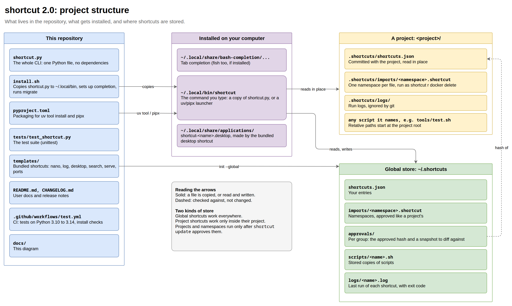
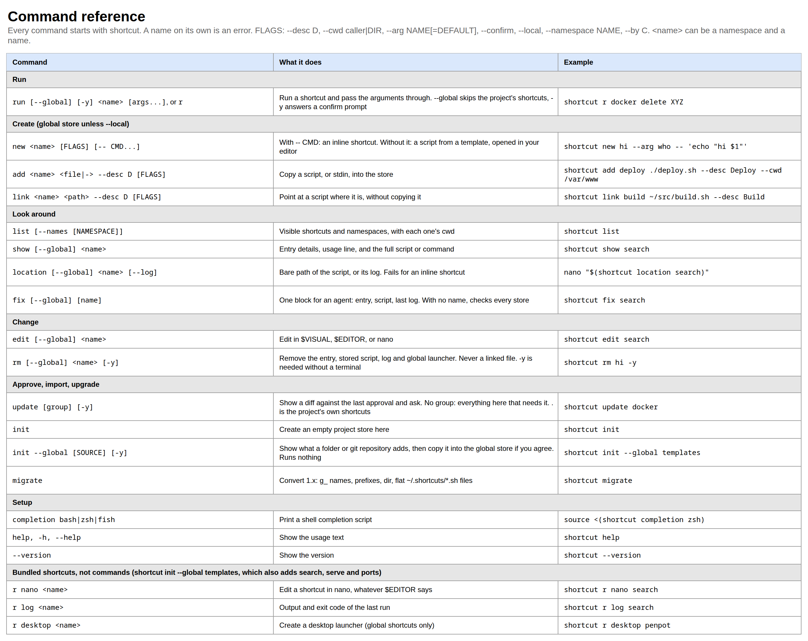

# shortcut

Run scripts fast; agents set them up for you.

`shortcut` is a single-file, zero-dependency CLI (Python >=3.10 standard library only) designed to save, organize, and execute scripts and commands. Agents register commands with helpful descriptions, and users run, inspect, and modify them with `shortcut r <name>`.

---

## Installation

Requirements: Linux (or another POSIX system) with Python 3.10+, bash, and git (only for `init --global` from a git URL). `nano` and `notify-send` are optional.

With [uv](https://docs.astral.sh/uv/) or [pipx](https://pipx.pypa.io/):

```bash
uv tool install git+https://github.com/StanLukuvka/Shortcut
pipx install git+https://github.com/StanLukuvka/Shortcut
```

Then set up completion yourself, for example `source <(shortcut completion bash)` in `~/.bashrc`.

Or clone the repository and run the installer, which also sets up completion:

```bash
git clone https://github.com/StanLukuvka/Shortcut.git
cd Shortcut
./install.sh
```

The installer copies one file (`shortcut.py`, installed as `shortcut`). Re-run it after `git pull` to upgrade.

By default, `install.sh` installs:
- Executable: `~/.local/bin/shortcut`
- Bash completion: `~/.local/share/bash-completion/completions/shortcut`
- Fish completion, if fish is installed: `~/.config/fish/completions/shortcut.fish`
- Global store: `~/.shortcuts/`

### Environment Overrides

You can customize the destination paths by setting environment variables during installation or execution:

| Variable | Default | Purpose |
|---|---|---|
| `BIN_DIR` | `~/.local/bin` | Binary installation target directory |
| `XDG_DATA_HOME` | `~/.local/share` | Data root for desktop entries and bash completions |
| `SHORTCUTS_HOME` | `~/.shortcuts` | Global shortcuts store root |

---

## Diagrams

The editable source for these is [docs/shortcut-overview.drawio](docs/shortcut-overview.drawio).

### Structure



### How a name runs


### Working with it


### Commands



### Checklists


---

## Stores and where they run

A shortcut lives in one of two kinds of store, and that alone decides where it is visible:

| Store | Visible | Created with |
|---|---|---|
| Global store (`$SHORTCUTS_HOME`) | Everywhere | `new`, `add`, `link` |
| A project's `.shortcuts/` | Inside that project, once approved | The same, with `--local` |

Where it runs is a separate choice, the `cwd` field:

| `cwd` | Runs in |
|---|---|
| `"caller"` (the default) | Your current directory |
| A relative path (`"."`, `"../frontend"`) | That path, relative to the folder of the file that defines the shortcut |
| An absolute path | That directory |

For a project's own shortcuts the defining file is `.shortcuts/shortcuts.json`, so `".."` is the project root. `--cwd` takes a path as you'd type it in your shell and stores the right value: `shortcut new test --local --cwd .` run in the project root stores `".."`.

Before it runs anything, `shortcut` prints the run directory as one dim line on stderr, so it never mixes with the output:

```
→ /home/you/code/c-app
```

Set `SHORTCUT_SHOW_DIR=0` to turn it off.

### Confirming before a run

An author can set `"confirm": true` (`--confirm`). `shortcut` then asks `run '<name>' in <dir>? [y/N]` first. `shortcut r -y <name>` answers yes, and without a terminal the run fails unless you pass `-y`. Only the author decides this; `shortcut` never decides what needs confirming.

### Project shortcuts

A project's `.shortcuts/` is read in place, never copied, so it can be committed with the project. Relative script paths resolve against the project root and can't escape it with `../`.

Inside a project, a project shortcut wins over a global one with the same name, so a project can define its own `test` or `build`. The run line says so whenever that happens, `list` marks both entries, and `shortcut run --global <name>` runs yours.

### Namespaces

A namespace is a group of shortcuts, run as `shortcut r docker delete XYZ`. There are two ways to get one.

Create it as you go. `--group` adds to a namespace, creating the file if needed:

```bash
shortcut new delete --group docker --desc "Stop and remove a container" -- 'docker stop "$1" && docker rm "$1"'
shortcut update docker
```

Or import a `.shortcut` file: put it in the store's `imports/` folder, then run `shortcut update docker`. The file's name is the namespace's name. Files elsewhere can be listed in the store's `shortcuts.json`, relative to it, and the key is then the name:

```json
{
  "version": 2,
  "imports": { "docker": "../ops/docker.shortcut" },
  "shortcuts": {}
}
```

A `.shortcut` file is JSON, in the same format as `shortcuts.json`, so an entry takes the same [fields](#fields):

```json
{
  "version": 2,
  "description": "Docker housekeeping",
  "shortcuts": {
    "delete": {
      "description": "Stop and remove a container",
      "inline": "docker stop \"$1\" && docker rm \"$1\"",
      "args": [{ "name": "container", "required": true }],
      "confirm": true
    },
    "prune": {
      "description": "Remove unused images",
      "script": "scripts/prune.sh"
    }
  }
}
```

- `version` and `shortcuts` are required. `description` is optional and shows in `list`.
- There's no `name` field, so a file you download can't choose its own name.
- Nothing is embedded. A group that needs to be a single file uses `inline`; one with `script` entries is shared as a folder.
- Relative paths resolve against the file's folder. `--group` keeps script copies in `scripts/<namespace>/` there.
- Your editor won't treat `.shortcut` as JSON until you tell it to, for example with `files.associations` in VS Code.

Namespaces are one level deep, so a `.shortcut` file can't have its own `imports`. A namespace and a shortcut with the same name in one store is an error, because `shortcut r docker delete` could then mean either; that store's shortcuts won't run until one is renamed, and `shortcut fix` shows why.

### Declared arguments

Without an `args` key a shortcut gets whatever you pass it. With one, `shortcut` checks the arguments before running:

```json
{
  "description": "Stop a container",
  "script": "scripts/delete.sh",
  "args": [
    { "name": "container", "required": true, "desc": "Which one" },
    { "name": "signal", "default": "TERM" },
    { "name": "extra", "rest": true }
  ]
}
```

- Required arguments must be there, missing ones get their default, and more arguments than declared is an error unless the last one is `rest`. A failure prints `usage: shortcut r docker delete <container> [signal] [extra...]`.
- Arguments arrive as `$1`, `$2`, … and as `SC_ARG_CONTAINER`, `SC_ARG_SIGNAL`, … (a `rest` argument's variable holds them shell-quoted).
- `--flags` are never parsed. They don't count as arguments and reach the script untouched.
- Values are never validated: `shortcut` checks presence and count only.

`shortcut show` prints the usage line, and `new`, `add` and `link` take `--arg name` (required) and `--arg name=default`.

---

## Security model

> shortcut runs exactly what its definitions say, without inspecting them.
> A project's or import's shortcuts don't run until you approve them with
> `shortcut update`, and must be re-approved after any change.
> Anyone who can write to your shortcut store can already run code as
> you; that's out of scope.

Each project store and each namespace is a group, approved on its own. `shortcut update` refuses a group if any of its entries couldn't run, otherwise it shows a diff against what you last approved (everything, the first time) and asks. A group that changed since then refuses to run until you do, for example after a `git pull`:

```
docker changed since you approved it; run: shortcut update docker
```

Other groups keep working. Nothing prompts without a terminal, so an agent or a script gets that error instead.

This covers `shortcuts.json`, or the `.shortcut` file, and every file named by a `script` field. Changes you make through `shortcut` itself (`new --local`, `new --group`, `edit`, `rm`) count too, and `shortcut` reminds you. Approvals and snapshots live in your global store under `approvals/`, keyed by the project or import path, never inside what they approve. Moving a project means approving it again.

An approved group's `inline` commands are covered as text, but anything they call is not, and neither are files a script reads or sources. Read what you approve.

---

## JSON Entry Format

Shortcut registries are stored in `shortcuts.json` files within either the global store (`$SHORTCUTS_HOME/shortcuts.json`) or a project (`<project>/.shortcuts/shortcuts.json`).

### Storage Layout

```
<store>/
├── shortcuts.json         # Atomic JSON registry
├── imports/               # Namespaces: one <name>.shortcut each
├── scripts/               # Stored copies of managed executable scripts
│   └── <name>.<ext>
└── logs/                  # Tee execution logs from previous runs
    └── <name>.log
```

The global store also holds `approvals/`. A project store gets a `.gitignore` for its `logs/`.

### Registry Example

```json
{
  "version": 2,
  "shortcuts": {
    "search": {
      "description": "Search files under cwd",
      "script": "scripts/search.sh",
      "created": "2026-11-05"
    },
    "penpot": {
      "description": "Start Penpot (http://localhost:9001)",
      "inline": "podman pod start pod_penpot",
      "cwd": "/home/you",
      "created": "2026-11-05"
    },
    "deploy": {
      "description": "Deploy to production",
      "script": "/home/you/code/c-app/deploy.sh",
      "cwd": "/home/you/code/c-app",
      "confirm": true,
      "created": "2026-11-05"
    }
  }
}
```

Unknown fields are errors, at the top of a file, in an entry and in `args`. A field `shortcut` doesn't recognise could be a safety setting from a newer version, so it's never silently ignored. A file with a higher `version` than this `shortcut` reads is refused, with a prompt to upgrade.

### Fields

- `description` *(string, required on add/link)*: Human-readable summary of the shortcut.
- `inline` *(string)*: Direct command executed via `bash -c "<inline>" <name> "$@"`. Mutually exclusive with `script`.
- `script` *(string)*: Path to script. Relative paths resolve inside the global store, inside the project root for a project shortcut, or next to the imported file for a namespace, and must not escape it. Absolute paths reference external files without copying. A script with a `#!` line runs with that interpreter even without +x, and an executable binary runs directly. A missing script is an error.
- `cwd` *(string, default `"caller"`)*: Where it runs; see [Stores and where they run](#stores-and-where-they-run).
- `confirm` *(boolean, default false)*: Ask before running; see [Confirming before a run](#confirming-before-a-run).
- `args` *(list, optional)*: Declared arguments; see [Declared arguments](#declared-arguments).
- `icon` *(string, optional)*: Freedesktop icon name for desktop entries (defaults to `utilities-terminal`).
- `created` *(string, optional)*: ISO date (`YYYY-MM-DD`) when created.
- `created_by` *(string, optional)*: User or agent identifier recorded with `--by`.
- `log` *(boolean, default true)*: When enabled, output streams to the terminal and is also written to `logs/<name>.log` with the exit code. In a terminal the script runs on its own pseudo-terminal (like `script(1)`), so colours, progress bars and full-screen programs work as usual; when output is piped it is plain. Your keystrokes are passed through to that pseudo-terminal too: a full-screen program reads keys from the same terminal it draws on, so it would not see them otherwise. Set `"log": false` to give the script the terminal directly, for example if you need Ctrl+Z job control, which logged runs turn off.

---

## Command Reference

These commands are the core, and they keep working when a store is broken. Everything else is a shortcut; see [Bundled shortcuts](#bundled-shortcuts). `<name>` is a shortcut's name, or a namespace and a name.

### `shortcut run [--global] [-y] <name> [args...]` (or `shortcut r`)
Execute a shortcut, passing trailing arguments through verbatim. `--global` skips the project's store, `-y` answers a `confirm` prompt:
```bash
shortcut run search "*.py"
shortcut r search "*.py"    # r is short for run
shortcut r docker delete XYZ
```
Commands and shortcut names never collide, so a shortcut can be called `new` or `list`. A name on its own is not a command: `shortcut search` prints an error pointing here.

### Creating: `new`, `add`, `link`
All three go to the global store unless you pass `--local`, and to its main file unless you pass `--group`. They take these flags:

| Flag | Meaning |
|---|---|
| `--desc D` | Description (required on `add` and `link`) |
| `--cwd caller\|DIR` | Where it runs (default: caller) |
| `--arg NAME[=DEFAULT]` | Declare an argument, repeatable |
| `--confirm` | Ask before running it |
| `--local` | Store it in the project: the nearest `.shortcuts/` above you, or a new one here |
| `--group NAME` | Put it in namespace `NAME`, creating `imports/NAME.shortcut` if needed |
| `--by C` | Creator identifier |

`shortcut new <name> [FLAGS] [-- CMD...]` creates an inline shortcut, or a script from a template that opens in `$VISUAL` / `$EDITOR` (nano if neither is set). The shortcut is created only if the editor exits successfully. Without a terminal (for example when an agent runs it), the editor is skipped and the script's path is printed.

Put the command in single quotes, so `$1` reaches the shortcut instead of being expanded by your shell right now:
```bash
shortcut new hello --desc "Greet user" --arg who=world -- 'echo "Hello, $1"'
shortcut run hello          # Hello, world
```

`shortcut add <name> <file|-> --desc D [FLAGS]` copies an existing script or stdin into the store:
```bash
shortcut add deploy ./deploy.sh --desc "Deploy service" --cwd /var/www
```

`shortcut link <name> <path> --desc D [FLAGS]` references an external script by absolute path without copying:
```bash
shortcut link build ~/src/build.sh --desc "Build project binary"
```

### `shortcut list [--names]`
List visible shortcuts and namespaces, with where each runs. An unapproved group shows only how to review it:
```bash
shortcut list
shortcut list --names
```

### `shortcut show <name>`
Inspect metadata, the usage line, and script or inline contents:
```bash
shortcut show search
```

### `shortcut edit <name>`
Edit the stored script or inline command in `$VISUAL`, `$EDITOR`, or nano if neither is set:
```bash
shortcut edit search
```

### `shortcut location <name> [--log]`
Print the path of the script, and nothing else, so it can be used in commands. An inline shortcut has no file, so this fails. `--log` prints the path of its log instead:
```bash
code "$(shortcut location search)"
```

### `shortcut rm <name> [-y]`
Remove the shortcut, its stored script copy, log file, and desktop launcher:
```bash
shortcut rm hello -y
```

### `shortcut fix [name]`
Print one complete diagnostic block for agent troubleshooting. Without a name, check every visible store and namespace:
```bash
shortcut fix search
shortcut fix
```

### `shortcut update [group] [-y]`
Review what changed in a group and approve it (see [Security model](#security-model)). With no group, it goes through everything here that needs approving; `shortcut update docker` is one namespace, and `shortcut update .` is the project's own shortcuts. `-y` skips the question, for scripts; without a terminal it is required. Long diffs go through `$PAGER`:
```bash
shortcut update
```

### `shortcut init` / `shortcut init --global [SOURCE]`
`shortcut init` creates an empty project store (`.shortcuts/`) in the current directory. To use a project that already has one, clone it and run `shortcut update` there; it is never copied.

`--global SOURCE` copies a collection (a folder or git URL) into your global store. Nothing is run. Names that already exist, symlinks, paths that escape the source, and relative `cwd` values are skipped and reported:
```bash
shortcut init
shortcut init --global https://github.com/example/dev-shortcuts.git
shortcut init --global templates          # the bundled shortcuts in this repository
```

### `shortcut migrate`
Convert 1.x shortcuts, in your global store and the project you're in: `g_search` becomes `search` with `cwd: caller`, `dir` becomes `cwd`, a registered prefix becomes a `cwd` on its shortcuts (their names stay), and a project shortcut keeps running at its root with `cwd: ".."`. A name that's already taken is reported and left as it was, never overwritten. Flat `~/.shortcuts/*.sh` scripts become entries too. A migrated project needs approving, and approvals from 1.x don't carry over:
```bash
shortcut migrate
```

### `shortcut completion bash|zsh|fish`
Output a shell completion script. The installer sets up bash, and fish when it is installed. For zsh, add this to `~/.zshrc` after `compinit`:
```bash
source <(shortcut completion zsh)
```

### `shortcut help` / `shortcut --version`
Display the CLI usage manual or version number:
```bash
shortcut help
shortcut --version
```

---

## Bundled shortcuts

`templates/` holds a collection built only from the commands above. `shortcut init --global templates` copies it into your global store, skipping names you already have:

| Shortcut | Does |
|---|---|
| `shortcut r nano <name>` | Edit a shortcut in nano, whatever `$EDITOR` says |
| `shortcut r log <name>` | Print the output and exit status of its last run |
| `shortcut r desktop <name>` | Create a Freedesktop `.desktop` launcher under `$XDG_DATA_HOME/applications/`, for a global shortcut |
| `shortcut r search <pattern> [path]` | Find files by name |
| `shortcut r serve [port]` | Serve the current directory over HTTP |
| `shortcut r ports` | List listening ports |

They're ordinary shortcuts: read them with `shortcut show`, change them with `shortcut edit`, or replace them. `uv tool install` and `pipx install` don't include `templates/`; use it from a clone.

---

## For Agents

When creating shortcuts for users:
1. **Register with description**: Always supply `--desc` so users understand what the shortcut accomplishes:
   ```bash
   shortcut new test --local --desc "Run full integration test suite" --cwd . -- 'pytest tests/'
   ```
2. **Choose where it lives and runs**:
   - The default suits general-purpose tools: global, running in the caller's working directory.
   - Use `--local` for project-specific operations (builds, test runners, linters). The user has to run `shortcut update` in that project before it runs; `new` says so.
   - Use `--cwd <dir>` when a process must execute in a specific folder.
3. **Notify the user**: When a task is ready, tell the user:
   > Run it: `shortcut r <name>`
4. **Diagnose failures**: If a shortcut fails, run `shortcut fix <name>` to inspect the registered JSON, script contents, and the latest execution log ending with the exit code.

---

## Upgrading from 1.x

`install.sh` runs `shortcut migrate` on your global store. If you installed with uv or pipx, run it yourself, and run it in each project with a `.shortcuts/`. Then:

- Run shortcuts with `shortcut r <name>`, and without the `g_`.
- Run `shortcut update` in each project; `shortcut allow` is gone.
- Run `shortcut init --global templates` from a clone to get `log`, `desktop` and `nano`, which are now shortcuts. Launchers made by `shortcut desktop` keep working unless the shortcut's name lost its `g_`.

---

## Development

Run the test suite (it never touches your real `~/.shortcuts`; every test uses a temporary `HOME`):

```bash
python3 -m unittest discover -s tests -v
```

## Uninstall

```bash
rm ~/.local/bin/shortcut ~/.local/share/bash-completion/completions/shortcut
rm -f ~/.config/fish/completions/shortcut.fish
rm ~/.local/share/applications/shortcut-*.desktop   # desktop launchers, if any
rm -r ~/.shortcuts                                  # your shortcuts — only if you want them gone
```

## License

MIT — see [LICENSE](LICENSE).
