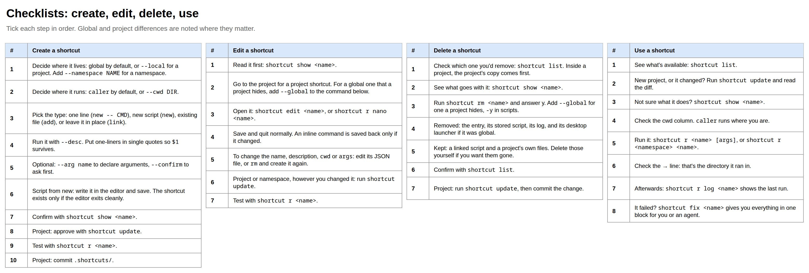
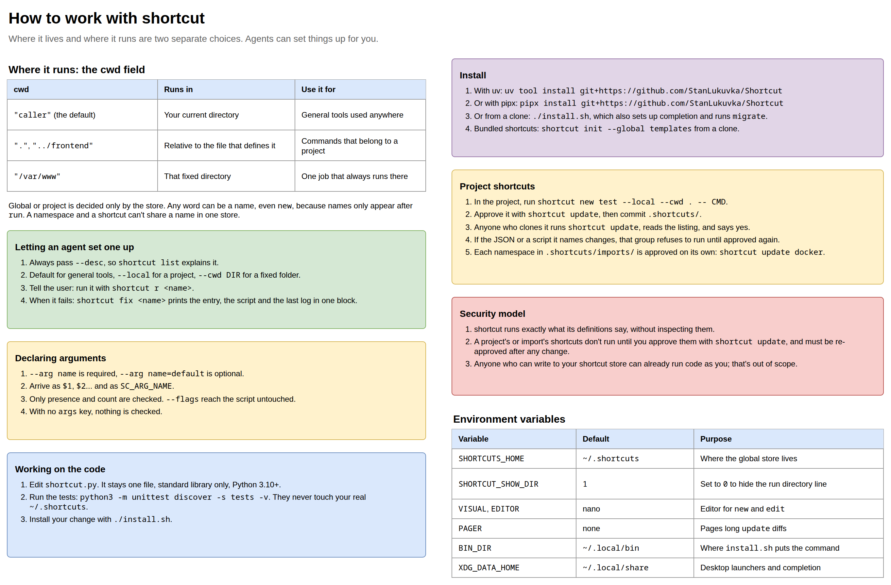

# shortcut

Run scripts fast; agents set them up for you.

```console
$ shortcut new todos --desc "Find TODOs under a folder" --arg path=. -- 'grep -rn TODO "$1"'
Created inline shortcut 'todos'.

$ cd ~/code/api
$ shortcut r todos src
→ /home/you/code/api
src/server.py:41:    # TODO: retry on timeout

$ shortcut list
Global shortcuts:
  todos                caller  Find TODOs under a folder
```

`shortcut` gives a command or script a name you can run from any directory. It is one Python file with no dependencies.

- **Keep what you'd otherwise lose.** A one-liner gets a name, a description and a line in `shortcut list`, instead of sitting in your shell history.
- **Let agents do the setup.** A coding agent saves the command it just worked out and tells you what to run. If it fails later, `shortcut fix` hands the agent everything it needs in one block.
- **See what happened.** Each shortcut keeps the output and exit code of its last run.
- **Commit shortcuts with a project.** They don't run on anyone's machine until that person has approved them, and they need approving again after any change to them.

[Install](#install) · [Quick start](#quick-start) · [Concepts](#concepts) · [Security model](#security-model) · [For agents](#for-agents) · [Reference](#reference) · [Upgrading from 1.x](#upgrading-from-1x)

## Install

You need Linux or another POSIX system, Python 3.10+ and bash. `git` is only needed for `init --global` from a git URL. `nano` is the fallback editor and `notify-send` is used by desktop launchers; both are optional.

Install with [uv](https://docs.astral.sh/uv/) or [pipx](https://pipx.pypa.io/):

```bash
uv tool install git+https://github.com/StanLukuvka/Shortcut
```

```bash
pipx install git+https://github.com/StanLukuvka/Shortcut
```

Then set up completion yourself, for example with `source <(shortcut completion bash)` in `~/.bashrc`.

Or install from a clone, which also sets up bash completion (and fish, if you have it) and gives you the [bundled shortcuts](#bundled-shortcuts) to import:

```bash
git clone https://github.com/StanLukuvka/Shortcut.git
cd Shortcut
./install.sh
```

`install.sh` copies `shortcut.py` to `~/.local/bin/shortcut`. Re-run it after `git pull` to upgrade. To install elsewhere, see [Environment variables](#environment-variables).

## Quick start

**Save a command.** Single quotes matter: they let `$1` reach the shortcut instead of being expanded by your shell right now.

```bash
shortcut new branches --desc "Recent branches" --arg count=10 -- 'git branch --sort=-committerdate | head -n "$1"'
shortcut r branches 5
```

**Save a script.** Write a new one, copy one in, or point at one where it is:

```bash
shortcut new backup --desc "Back up the photos folder"     # opens your editor on a new script
shortcut add deploy ./deploy.sh --desc "Deploy the site"   # copies it into the store
shortcut link build ~/src/build.sh --desc "Build binaries" # uses it where it is
```

**Look around.** `shortcut list` shows everything you can run here, and `shortcut show <name>` prints one shortcut in full, including its script.

**Add one to a project.** `--local` stores it in the project and `--cwd .` makes it run at the project root, wherever you call it from. You review it once with `shortcut update`, then commit it:

```console
$ cd ~/code/api
$ shortcut new test --local --desc "Run the tests" --cwd . -- 'pytest -q "$@"'
created project store /home/you/code/api/.shortcuts
note: /home/you/code/api needs approving before it runs: shortcut update
Created inline shortcut 'test'.

$ shortcut update
New to you: /home/you/code/api
--- a/cwd of test
+++ b/cwd of test
@@ -0,0 +1 @@
+/home/you/code/api
--- a/.shortcuts/shortcuts.json
+++ b/.shortcuts/shortcuts.json
@@ -0,0 +1,11 @@
+{
+  "shortcuts": {
+    "test": {
+      "created": "2026-11-06",
+      "cwd": "..",
+      "description": "Run the tests",
+      "inline": "pytest -q \"$@\""
+    }
+  },
+  "version": 2
+}
approve? [y/N] y
Approved /home/you/code/api. This covers its definitions, not what they call. Any change to them needs `shortcut update` again.

$ shortcut r test
→ /home/you/code/api
.                                                                        [100%]
1 passed in 0.02s

$ git add .shortcuts
```

Anyone who clones the repository runs `shortcut update`, reads the same listing and approves it for themselves.

**When something fails,** `shortcut fix <name>` prints the entry, its command or script, and the last run's output and exit code in one block. Run it yourself or give it to an agent.

These checklists cover the whole life of a shortcut:



## Concepts

### Stores

A shortcut lives in a store, and the store decides where you can see it.

| Store | Location | Visible | Approval |
|---|---|---|---|
| Global | `~/.shortcuts` | Everywhere | [Namespaces](#namespaces-and-groups) only |
| Project | `.shortcuts/` in a project | In that project and its subfolders | [Everything](#security-model) |

`new`, `add` and `link` write to the global store. With `--local` they write to the project store instead: the nearest `.shortcuts/` above you, or a new one in the current directory.


### Where it runs

Where a shortcut lives and where it runs are separate choices. The `cwd` field decides where it runs:

| `cwd` | Runs in |
|---|---|
| `"caller"` (the default) | Your current directory |
| A relative path (`"."`, `"../frontend"`) | That path, relative to the folder of the file that defines the shortcut |
| An absolute path, or one starting with `~` | That directory |

The defining file of a project's own shortcuts is `.shortcuts/shortcuts.json`, so `".."` is the project root.

You don't need to work that out. `--cwd` takes a path as you'd type it in your shell, which must exist, and stores the right value: `shortcut new test --local --cwd . -- pytest` run in the project root stores `".."`. A path inside a project is stored relative to it, so it still works after someone else clones it.

### What happens when you run a shortcut


**The run line.** Before running anything, `shortcut` prints the real path of the run directory (`→ /home/you/code/api`) as one dim line on stderr, so it never mixes with the output. Set `SHORTCUT_SHOW_DIR=0` to turn it off.

**Flags go before the name.** Everything after the name belongs to the shortcut. `shortcut r -y deploy` answers a confirmation prompt; `shortcut r deploy -y` passes `-y` to the script.

**Names are only names after `run`.** `shortcut search` is an error that points you to `shortcut run search`, which is why a shortcut can be called `new` or `list`.

**How it starts.** An `inline` command runs as `bash -c "<inline>" <name> "$@"`. A script with a `#!` line runs with that interpreter, even without +x. An executable ELF binary runs directly. Anything else runs with `bash`.

**Exit codes.** `shortcut r` exits with the shortcut's exit code. A shortcut killed by a signal gives 128+N, so one that loses its reader in `| head` gives 141. Arguments that don't fit the [declared arguments](#arguments) exit 2 before anything runs.

**Confirmation.** An author can set `"confirm": true` (`--confirm`), and `shortcut` then asks `run '<name>' in <real path>? [y/N]` first. `shortcut r -y <name>` answers yes, and without a terminal the run fails unless you pass `-y`. Declining prints `Aborted.` to stderr and exits 1, as it does for `rm`, `update` and `init --global`. Only the author decides this; `shortcut` never decides what needs confirming.

### Arguments

Without an `args` key, a shortcut gets whatever you pass it. An inline command has to read those arguments itself: unlike an alias, a shortcut doesn't append them for you, so `rg --hidden` needs to be `rg --hidden "$@"`. `new` tells you when a command doesn't read them.

With an `args` key, `shortcut` checks the arguments before running:

```json
"stop": {
  "description": "Stop a container",
  "script": "scripts/stop.sh",
  "args": [
    { "name": "container", "required": true },
    { "name": "signal", "default": "TERM" },
    { "name": "extra", "rest": true }
  ]
}
```

```console
$ shortcut r stop
error: missing <container>
usage: shortcut r stop <container> [signal] [extra...]
```

- Required arguments must be there and missing ones get their default. More arguments than declared is an error, unless the last one is `rest`.
- Arguments arrive as `$1`, `$2`, and so on, and as `SC_ARG_CONTAINER`, `SC_ARG_SIGNAL`, and so on. Names are upper-cased and `-` becomes `_`. A `rest` argument's variable holds its values shell-quoted.
- `--flags` are never parsed. They reach the script untouched, in the place you typed them, and don't count as arguments. So `$1` may be a flag, and in `--signal KILL` the `KILL` still counts. Prefer `SC_ARG_*` if your script takes flags.
- Values are never validated: `shortcut` checks presence and count only.

`new`, `add` and `link` declare arguments with `--arg name` (required) and `--arg name=default`. A `rest` argument has to be written in the JSON. `shortcut show` prints the usage line.

### Output and logs

Output goes to your terminal and to a log in your global store, which ends with the exit code: `logs/<name>.log`, or `logs/<id>/<name>.log` for a project's shortcut. Projects hold no logs, so a symlink committed to a repository can't turn a run into a write to another file. Each run replaces the previous log. Colours, progress bars and full-screen programs work as usual. To read a log, use `shortcut location --log <name>` or the bundled [`log`](#bundled-shortcuts) shortcut.

A logged run differs from running the script by hand in two ways: stdout and stderr become one stream, so `2>/dev/null` won't hide the script's errors, and Ctrl+Z is turned off. Set `"log": false` to give the script the terminal directly, with no log.

### Project shortcuts

A project's `.shortcuts/` is read in place, never copied, so it can be committed with the project. It comes with a `.gitignore` for its lock file. `shortcut init` creates an empty one; `--local` creates one when it needs to.

Relative script paths resolve against the project root and can't escape it with `../`.

Inside a project, a project shortcut wins over a global one with the same name, so a project can define its own `test` or `build`. The run line says so whenever that happens, `list` marks both entries, and `shortcut run --global <name>` runs yours. `show`, `edit`, `location`, `rm` and `fix` take `--global` too. An unapproved project shortcut is refused, never swapped for the global one.

A project [namespace](#namespaces-and-groups) hides a global namespace with the same name in the same way, but only `list` shows it.

### Namespaces and groups

A *namespace* is a named set of shortcuts, stored in one `.shortcut` file. You run its shortcuts with two words:

```bash
shortcut new delete --namespace docker --desc "Stop and remove a container" --arg container -- 'docker stop "$1" && docker rm "$1"'
shortcut update docker
shortcut r docker delete web-1
```

A *group* is what you approve. Every namespace is a group, and so is a project's own `shortcuts.json`; each is approved on its own, so a change to one doesn't block the others. Namespaces need approving in the global store too. The global store's own `shortcuts.json` is the only file that needs no approval.

There are two ways to make a namespace:

- **As you go.** `--namespace NAME` on `new`, `add` or `link` adds to namespace `NAME`, creating `imports/NAME.shortcut` in the store if needed. It combines with `--local`.
- **From a file.** Put a [`.shortcut` file](#shortcut-files) in the store's `imports/` folder and run `shortcut update docker`. The file's name is the namespace's name. A file elsewhere can be listed in the store's `shortcuts.json`, relative to it, and the key is then the name:

  ```json
  {
    "version": 2,
    "imports": { "docker": "../ops/docker.shortcut" },
    "shortcuts": {}
  }
  ```

Namespaces are one level deep, so a `.shortcut` file can't have its own `imports`.

A namespace and a shortcut with the same name in one store is an error, because `shortcut r docker delete` could then mean either. That store's shortcuts won't run until one is renamed, and `shortcut fix` shows why.

To remove a namespace, delete its `.shortcut` file. `rm` only removes the shortcuts inside it.

### On one page



## Security model

> 1. shortcut runs exactly what its definitions say, without inspecting them.
> 2. A project's or import's shortcuts don't run until you approve them with `shortcut update`, and must be re-approved after any change to their definitions.
> 3. Approval covers definitions and the scripts they name, not the programs those call.
> 4. Global shortcuts have no approval step, so a global link target can change freely. `init --global` shows a collection before copying it.
> 5. Anyone who can write to your shortcut store can already run code as you; that's out of scope.

`shortcut update` refuses a [group](#namespaces-and-groups) if any of its entries couldn't run. Otherwise it shows a diff against what you last approved (everything, the first time) and asks. A group that changed since then refuses to run until you approve it again, for example after a `git pull`:

```
error: docker changed since you approved it; run: shortcut update docker
```

Other groups keep working. Nothing prompts without a terminal, so an agent or a script gets that error instead.

Approval covers the `shortcuts.json` or `.shortcut` file, every file named by a `script` field, even one linked from outside the project, and where a relative `cwd` really leads, so moving a symlink under it needs approving. Changes you make through `shortcut` itself (`new --local`, `new --namespace`, `edit`, `rm`) count too, and `shortcut` reminds you. Approvals and snapshots live in your global store under `approvals/`, keyed by the project or import path, never inside what they approve. Moving a project means approving it again.

Approval has limits. An approved group's `inline` commands are covered as text, but the programs they call are not, and neither are files a script reads or sources. Read what you approve. "No approval step" means the global store's own shortcuts; namespaces in it are approved like a project's. Anything [`init --global`](#approve-import-upgrade) copies in can run straight away, so its one review is the listing it shows you first.

The screen you approve on can't be rewritten. Control characters in anything `shortcut` prints show as `^[` and similar; only a shortcut's own output reaches your terminal unchanged. A script with a bad byte or a NUL shows as text with the bytes escaped. A compiled ELF program stays hidden, so approving one means typing `binary` at the prompt. `-y` skips that too.

## For agents

Use the same commands a person would. When you set up a shortcut for a user:

1. **Always pass `--desc`,** so the user can tell what the shortcut does. `--by <your name>` records who made it.

   ```bash
   shortcut new test --local --desc "Run full integration test suite" --cwd . -- 'pytest tests/ "$@"'
   ```

2. **Choose where it lives and runs.**
   - General-purpose tool: use the default, which is global and runs in the caller's directory.
   - Project-specific work (builds, test runners, linters): use `--local`.
   - A process that must run in a specific folder: use `--cwd <dir>`.

3. **Single-quote the command** and read arguments with `$1` or `"$@"`. A shortcut doesn't append them for you.

4. **Leave approval to the user.** A shortcut made with `--local` or `--namespace` doesn't run until the user has run `shortcut update`; `new` prints the exact command. Don't approve on their behalf with `-y`.

5. **Tell the user how to run it:**

   > Run it: `shortcut r <name>`

6. **Diagnose failures with `shortcut fix <name>`.** It prints the entry JSON, the script or command, and the last run's log and exit code. `shortcut fix` with no name reports the state of every visible store and namespace.

Without a terminal:

- `shortcut new <name>` without `-- CMD` skips the editor, creates a script from the template and prints its path, so you can write to that file.
- `shortcut rm` needs `-y`.
- A shortcut with `confirm` fails without `shortcut r -y <name>`. The author asked for a human decision, so check with the user first.

To see what exists, use `shortcut list --names` and `shortcut show <name>`. Writes to a store are locked, so agents working at the same time don't overwrite each other.

## Reference

### Commands


`<name>` always means a shortcut's name, or a namespace and a name: `shortcut show docker delete`.

#### Run

`shortcut run [--global] [-y] <name> [args...]`, or `shortcut r`.

`--global` skips the project's shortcuts. `-y` answers a [confirmation](#what-happens-when-you-run-a-shortcut) prompt. Trailing arguments pass through verbatim.

#### Create

```
shortcut new  <name> [FLAGS] [-- CMD...]
shortcut add  <name> <file|-> --desc D [FLAGS]
shortcut link <name> <path> --desc D [FLAGS]
```

| Flag | Meaning |
|---|---|
| `--desc D` | Description (required on `add` and `link`) |
| `--cwd caller\|DIR` | [Where it runs](#where-it-runs) (default: caller) |
| `--arg NAME[=DEFAULT]` | [Declare an argument](#arguments), repeatable |
| `--confirm` | Ask before running it |
| `--local` | Store it in the project, not globally |
| `--namespace NAME` | Put it in [namespace](#namespaces-and-groups) `NAME` |
| `--by C` | Record who created it |

**`new`** with `-- CMD` creates an inline shortcut. Quote the whole command, as in the [quick start](#quick-start). Without the quotes, each word after `--` is kept as one word, exactly as typed, except that `$1`, `$@`, `$*` and `${1}` stay live: `shortcut new say -- echo '$1'` stores `echo "$1"`.

Without `-- CMD`, `new` creates a script from a template and opens it in your editor. The shortcut is created only if the editor exits successfully, so a GUI editor needs its wait flag, for example `EDITOR="code --wait"`.

**`add`** copies a script, or stdin with `-`, into the store. **`link`** stores the script's absolute path and copies nothing, so `edit` changes your original and `rm` leaves it alone.

#### Look around

| Command | Does |
|---|---|
| `shortcut list [--names [NAMESPACE]]` | Lists visible shortcuts and namespaces, with each one's `cwd`. An unapproved group shows only how to review it. `--names` prints bare names for scripts and completion, and `--names docker` prints the names in that namespace. |
| `shortcut show [--global] <name>` | Prints the details, usage line and full script or command. It works before approval, so you can read a shortcut before trusting it. |
| `shortcut location [--global] <name> [--log]` | Prints the script's path and nothing else, for use in commands: `code "$(shortcut location search)"`. An inline shortcut has no file, so this fails. `--log` prints the log's path instead. |
| `shortcut fix [--global] [name]` | With a name, prints one diagnostic block: entry, script or command, last log, exit code. Without one, prints each visible store and namespace with its state, such as `definitions unchanged since approved`, or why it's broken; `--global` leaves out the project's. |

#### Change

`shortcut edit [--global] <name>` opens the script or inline command in `$VISUAL`, `$EDITOR`, or nano if neither is set. To change anything else (name, description, `cwd`, `args`), edit the JSON file that `shortcut show` names as `Defined in`, or `rm` the shortcut and create it again.

`shortcut rm [--global] <name> [-y]` removes the entry, its stored script copy, its log and any desktop launcher. It never removes a linked script or a project's own files. `-y` skips the question.

`list`, `fix` and `rm` still work on an invalid entry, such as one with an unknown field or with both or neither of `inline` and `script`, so you can find and remove it. `show`, `edit`, `location` and `run` refuse it. If the JSON itself is corrupt, `list` and `fix` report it and you repair the file by hand.

A global shortcut never stands in for one from a project whose `shortcuts.json` can't be read. `shortcut r <name>` refuses any name the project had when you last approved it, and `shortcut run --global <name>` still reaches the global one. Any other name falls through to the global store with a warning on stderr. `show`, `edit`, `location`, `rm` and `fix` don't refuse, but they print the same warning when they land on a global shortcut.

#### Approve, import, upgrade

`shortcut update [group] [-y]` reviews what changed and approves it ([Security model](#security-model)). With no group it goes through everything here that needs approving. `shortcut update docker` is one namespace, and `shortcut update .` is the project's own shortcuts. `-y` skips the question, for scripts; without a terminal it is required. If `$PAGER` is set, diffs taller than the terminal go through it.

`shortcut init` creates an empty project store (`.shortcuts/`) in the current directory. To use a project that already has one, clone it and run `shortcut update` there.

`shortcut init --global [SOURCE] [-y]` shows what a collection, a folder or git URL with a `shortcuts.json` at its root or in `.shortcuts/`, would add to your global store, asks `import? [y/N]`, and copies what it showed. Without a terminal it needs `-y`. Nothing is run now, but [nothing asks for approval later](#security-model) either. Only the file's own shortcuts are copied, not its namespaces. Names that already exist, symlinks, linked scripts, paths that escape the source, and `cwd` values that are relative or don't exist here are skipped and reported.

```bash
shortcut init --global https://github.com/example/dev-shortcuts.git
```

`shortcut migrate` converts 1.x stores; see [Upgrading from 1.x](#upgrading-from-1x).

#### Setup

`shortcut completion bash|zsh|fish` prints a completion script. The installer sets up bash, and fish when it is installed. For zsh, add this to `~/.zshrc` after `compinit`:

```bash
source <(shortcut completion zsh)
```

### Entry fields

Stores keep their shortcuts in a `shortcuts.json` file, and namespaces in a [`.shortcut` file](#shortcut-files). An entry takes these fields. It needs exactly one of `inline` and `script`.

| Field | Type | Meaning |
|---|---|---|
| `description` | string | Shown in `list` and `show` |
| `inline` | string | The command to run |
| `script` | string | Path to a script. A relative path starts at the global store, the project root or the `.shortcut` file's folder, and can't escape it. An absolute path is used as it is. |
| `cwd` | string | [Where it runs](#where-it-runs). Default `"caller"` |
| `confirm` | boolean | [Ask before running](#what-happens-when-you-run-a-shortcut). Default `false` |
| `args` | list | [Declared arguments](#arguments): `name`, plus optional `required`, `default`, `rest` and `desc`. `desc` is a note for people reading the file; nothing prints it. |
| `log` | boolean | [Log the output](#output-and-logs). Default `true` |
| `icon` | string | Freedesktop icon name for a desktop launcher. Default `utilities-terminal` |
| `created` | string | Date created, `YYYY-MM-DD` |
| `created_by` | string | Who created it, from `--by` |

Unknown fields are errors. A field `shortcut` doesn't recognise could be a safety setting from a newer version, so an entry, `args` list or `.shortcut` file containing one won't run. An unknown top-level field in a store's `shortcuts.json` stops `run` for everything in that store and blocks `update`, and `list` and `fix` report it. `show`, `edit`, `location` and `rm` still work there, so you can repair it. A file with a higher `version` than this `shortcut` reads is refused, with a prompt to upgrade.

### `.shortcut` files

A `.shortcut` file is JSON in the same format as `shortcuts.json`:

```json
{
  "version": 2,
  "description": "Docker housekeeping",
  "shortcuts": {
    "delete": {
      "description": "Stop and remove a container",
      "inline": "docker stop \"$1\" && docker rm \"$1\"",
      "args": [{ "name": "container", "required": true }],
      "confirm": true
    },
    "prune": {
      "description": "Remove unused images",
      "script": "scripts/prune.sh"
    }
  }
}
```

- `version` and `shortcuts` are required. `description` is optional and shows in `list`.
- There's no `name` field, so a file you download can't choose its own name.
- Nothing is embedded. A group that needs to be a single file uses `inline`; one with `script` entries is shared as a folder.
- Relative paths resolve against the file's folder, for both `script` and `cwd`.
- Your editor won't treat `.shortcut` as JSON until you tell it to, for example with `files.associations` in VS Code.

### Environment variables

| Variable | Default | Purpose |
|---|---|---|
| `SHORTCUTS_HOME` | `~/.shortcuts` | Where the global store lives |
| `SHORTCUT_SHOW_DIR` | `1` | Set to `0` to hide the run line |
| `VISUAL`, `EDITOR` | nano | Editor for `new` and `edit`. May include arguments |
| `PAGER` | none | Pages long `update` diffs |
| `XDG_DATA_HOME` | `~/.local/share` | Root for bash completion and desktop launchers |
| `XDG_CONFIG_HOME` | `~/.config` | Root for fish completion, in `install.sh` |
| `BIN_DIR` | `~/.local/bin` | Where `install.sh` puts the command |

Every shortcut also runs with these set:

| Variable | Value |
|---|---|
| `SHORTCUT_NAME` | Its name: `todos`, or `docker delete` in a namespace |
| `SHORTCUT_CALLER_CWD` | The directory you ran it from, whatever its `cwd` |
| `SC_ARG_<NAME>` | Each [declared argument](#arguments) |

### Store layout

```
<store>/
├── shortcuts.json                 # the store's own shortcuts
├── imports/
│   ├── <namespace>.shortcut       # one namespace each
│   └── scripts/<namespace>/       # script copies for that namespace
├── scripts/<name>.<ext>           # stored script copies
└── logs/                          # global store only
    ├── <name>.log                 # last run
    ├── <namespace>.<name>.log
    └── <id>/                      # one project's logs, named the same way
```

The global store also holds `approvals/`.

### Bundled shortcuts

`templates/` holds a collection built only from the commands above. From a clone, `shortcut init --global templates` copies it into your global store, skipping names you already have. `uv tool install` and `pipx install` don't include it.

| Shortcut | Does |
|---|---|
| `shortcut r nano <name>` | Edit a shortcut in nano, whatever `$EDITOR` says |
| `shortcut r log <name>` | Print the output and exit status of its last run |
| `shortcut r desktop <name>` | Create a launcher under `$XDG_DATA_HOME/applications/` for a global shortcut. It keeps the terminal open and, with `notify-send`, shows the result. |
| `shortcut r search <pattern> [path]` | Find files by name |
| `shortcut r serve [port]` | Serve the current directory over HTTP |
| `shortcut r ports` | List listening ports |

They're ordinary shortcuts: read them with `shortcut show`, change them with `shortcut edit`, or replace them.

## Upgrading from 1.x

`install.sh` runs `shortcut migrate`, which converts your global store and the project you're in. With uv or pipx, run it yourself. Either way, run it in each project with a `.shortcuts/`.

| 1.x | 2.0 |
|---|---|
| `g_search` (also `glob_`, `global_`) | `search`, with `cwd: caller` |
| `dir` field | `cwd` field |
| Registered prefix | A `cwd` on its shortcuts, whose names stay |
| Project shortcut | Same shortcut with `cwd: ".."`, so it still runs at the root |
| Flat `~/.shortcuts/*.sh` script | An entry with `cwd: caller` |

A name that's already taken is reported and left as it was, never overwritten. Then:

- Run shortcuts with `shortcut r <name>`, and without the `g_`.
- Run `shortcut update` in each project. Approvals from 1.x don't carry over, and `shortcut allow` is gone.
- Use `--cwd` instead of `--static`. `shortcut prefix` is gone.
- Run `shortcut init --global templates` from a clone to get `log`, `desktop` and `nano`, which are now shortcuts. Launchers made by `shortcut desktop` keep working unless the shortcut's name lost its `g_`, and `migrate` prints the command to recreate those.

## Development

The tests never touch your real `~/.shortcuts`; every test uses a temporary `HOME`.

```bash
python3 -m unittest discover -s tests -v
```

The diagrams are drawn in [docs/shortcut-overview.drawio](docs/shortcut-overview.drawio). The design review of 2.0.0 is in [docs/design-critique.md](docs/design-critique.md), with its [lifecycle diagram](docs/shortcut-lifecycle.png). Release notes are in [CHANGELOG.md](CHANGELOG.md).

## Uninstall

If you installed with uv or pipx, use `uv tool uninstall shortcut` or `pipx uninstall shortcut`. After `install.sh`, remove what it installed. Either way, the last two lines remove desktop launchers and your shortcuts, if you want them gone.

```bash
rm -f ~/.local/bin/shortcut ~/.local/share/bash-completion/completions/shortcut
rm -f ~/.config/fish/completions/shortcut.fish
rm -f ~/.local/share/applications/shortcut-*.desktop
rm -r ~/.shortcuts
```

## License

MIT. See [LICENSE](LICENSE).
