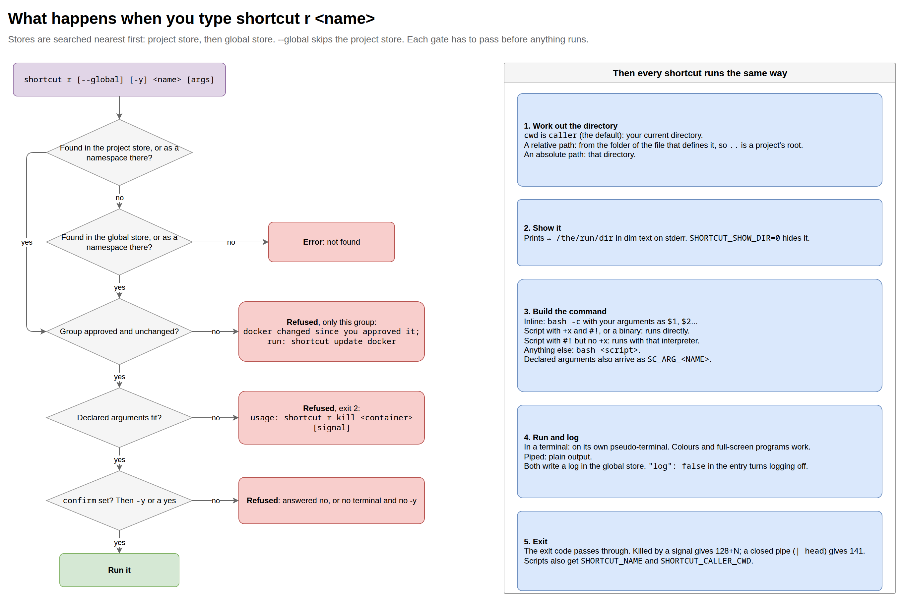

# shortcut

Names shell commands and scripts, and runs them from any directory.

```console
$ shortcut new todos --desc "Find TODOs under a folder" --arg path=. -- 'grep -rn TODO "$1"'
Created inline shortcut 'todos'.

$ cd ~/code/api
$ shortcut r todos src
→ /home/you/code/api
src/server.py:41:    # TODO: retry on timeout

$ shortcut list
Global shortcuts:
  todos                caller  Find TODOs under a folder
```

`shortcut` is one Python file with no dependencies.

- **Listing.** `shortcut list` shows each shortcut's name, `cwd` and description.
- **Agents.** A coding agent can create a shortcut and tell you what to run. `shortcut fix` prints what it needs to diagnose a failure in one block.
- **Logs.** Each shortcut keeps the output and exit code of its last run.
- **Projects.** Shortcuts can be committed with a project. They don't run on a machine until the person using it has approved them, and they need approving again after any change.

[Install](#install) · [Quick start](#quick-start) · [Concepts](#concepts) · [Security model](#security-model) · [For agents](AGENT.md) · [Reference](#reference) · [Upgrading from 1.x](#upgrading-from-1x)

## Install

You need Linux or another POSIX system, Python 3.10+ and bash. `git` is needed to install from a git URL, and for `init --global` from a git URL. `nano` is the fallback editor and `notify-send` is used by desktop launchers; both are optional.

Install with [uv](https://docs.astral.sh/uv/) or [pipx](https://pipx.pypa.io/):

```bash
uv tool install git+https://github.com/StanLukuvka/Shortcut
```

```bash
pipx install git+https://github.com/StanLukuvka/Shortcut
```

Then set up completion, for example with `source <(shortcut completion bash)` in `~/.bashrc`.

Or install from a clone. This also sets up bash completion, and fish if it is installed, and provides the [bundled shortcuts](#bundled-shortcuts) to import:

```bash
git clone https://github.com/StanLukuvka/Shortcut.git
cd Shortcut
./install.sh
```

`install.sh` copies `shortcut.py` to `~/.local/bin/shortcut`. Re-run it after `git pull` to upgrade. To install elsewhere, see [Environment variables](#environment-variables).

## Quick start

**Save a command.** Single quotes matter: they let `$1` reach the shortcut instead of being expanded by your shell right now.

```bash
shortcut new branches --desc "Recent branches" --arg count=10 -- 'git branch --sort=-committerdate | head -n "$1"'
shortcut r branches 5
```

**Save a script.** Write a new one, copy one in, or point at one where it is:

```bash
shortcut new backup --desc "Back up the photos folder"     # opens your editor on a new script
shortcut add deploy ./deploy.sh --desc "Deploy the site"   # copies it into the store
shortcut link build ~/src/build.sh --desc "Build binaries" # uses it where it is
```

**Look around.** `shortcut list` shows everything you can run here, and `shortcut show <name>` prints one shortcut in full, including its script.

**Add one to a project.** Run this at the project root. `--local` stores it in the project store. `--cwd .` records the current directory, and the shortcut runs there wherever you call it from. Review it with `shortcut update`, then commit it:

```console
$ cd ~/code/api
$ shortcut new test --local --desc "Run the tests" --cwd . -- 'pytest -q "$@"'
created project store /home/you/code/api/.shortcuts
note: /home/you/code/api needs approving before it runs: shortcut update
Created inline shortcut 'test'.

$ shortcut update
New to you: /home/you/code/api
--- a/cwd of test
+++ b/cwd of test
@@ -0,0 +1 @@
+/home/you/code/api
--- a/.shortcuts/shortcuts.json
+++ b/.shortcuts/shortcuts.json
@@ -0,0 +1,11 @@
+{
+  "shortcuts": {
+    "test": {
+      "created": "2026-11-06",
+      "cwd": "..",
+      "description": "Run the tests",
+      "inline": "pytest -q \"$@\""
+    }
+  },
+  "version": 2
+}
approve? [y/N] y
Approved /home/you/code/api. This covers its definitions, not what they call. Any change to them needs `shortcut update` again.

$ shortcut r test
→ /home/you/code/api
.                                                                        [100%]
1 passed in 0.02s

$ git add .shortcuts
```

Anyone who clones the repository runs `shortcut update`, reads the same diff and approves it.

**Diagnose a failure.** `shortcut fix <name>` prints a [diagnostic block](#look-around). Run it yourself or give it to an agent.

Checklists for creating, editing, deleting and using a shortcut:


## Concepts

### Stores

A store is a folder that holds shortcuts in a `shortcuts.json` file, plus any namespaces and script copies. There are two kinds:

| Store | Location | Visible | Approval |
|---|---|---|---|
| Global store | `~/.shortcuts`, or `SHORTCUTS_HOME` | Everywhere | [Namespaces](#namespaces-and-groups) only |
| Project store | `.shortcuts/` in a project | In that project and its subfolders | [Everything](#security-model) |


**Finding the project.** `shortcut` starts in the current directory and walks up. The first folder with a `.shortcuts/shortcuts.json` is the project, and that `.shortcuts/` is its project store. If there is none, you are outside a project. The global store and `~/.shortcuts` are never a project store.

**Commands.** This table shows which store each command uses. "Project store, then global store" means the first match is used.

| Command | Outside a project | Inside a project | `--global` | `--local` |
|---|---|---|---|---|
| `run`, `r`, `show`, `edit`, `location`, `rm`, `fix <name>` | Global store | Project store, then global store | Global store only | Not available |
| `fix` with no name | Reports the global store | Reports both stores | Reports the global store only | Not available |
| `list` | Global store | Both stores | Not available | Not available |
| `new`, `add`, `link` | Writes to the global store | Writes to the global store | Not available | Writes to the project store. Outside a project, creates one in the current directory |
| `update` | Namespaces in the global store | The project store, and namespaces in both stores | Not available | Not available |
| `init` | Creates a project store in the current directory | Creates a project store in the current directory, unless it has one | Different meaning, inside and outside a project: imports `SOURCE` into the global store, or with no `SOURCE` creates an empty global store | Not available |
| `migrate` | Global store | Global store and project store | Not available | Not available |
| `completion`, `help`, `--version` | No store | No store | Not available | Not available |

`new`, `add` and `link` write to the global store inside a project too. `edit` and `rm` change the first match, which inside a project can be the project store. `init` in a subfolder of a project creates a new project store there, and that subfolder is then the project.

`init`, and `--local` outside a project, refuse a folder whose `.shortcuts` is the global store or a symlink.

**Same name in both stores.** The project store wins. Inside a project, a project shortcut hides a global shortcut with the same name, and a project namespace hides a global namespace with the same name, including all its shortcuts. A project shortcut also hides a global namespace with the same name, and a project namespace hides a global shortcut. `--global` reaches the hidden one.

The run line and `show` say so when a project shortcut hides a global one, and `list` marks both entries. For hidden namespaces, `list` prints both and nothing else shows it. `shortcut show <name>` prints the file it found under `Defined in`.

An unapproved project shortcut is refused, never replaced by the global one.

**Unreadable `shortcuts.json`.** If a project's `shortcuts.json` can't be read, `shortcut r <name>` refuses any name the project had when you last approved it, and any name in the project's namespaces. `shortcut run --global <name>` reaches the global one. Any other name falls through to the global store with a warning on stderr. `show`, `edit`, `location`, `rm` and `fix <name>` can't see the project's shortcuts. A name only in the project gives `not found`. A name that is also in the global store lands on the global shortcut with the same warning, and `rm` then removes the global one. `list` and `fix` report the error. `update`, `new --local` and `migrate` stop with it. For a file that can be read but has an unknown field, see [Entry fields](#entry-fields).

**Namespaces.** A namespace belongs to the store that holds its file in `imports/` or lists it under `"imports"`. `--namespace NAME` writes to namespace `NAME` in the global store, or in the project store with `--local`. Looking up a name covers namespaces too: project store, then global store, and `--global` skips the project store's namespaces. If both stores have a namespace with the same name, `shortcut update <namespace>` approves the project store's. `shortcut update` with no group approves both.

### Where it runs

The `cwd` field sets the run directory. It is independent of the store.

| `cwd` | Runs in |
|---|---|
| `"caller"` (the default) | Your current directory |
| A relative path (`"."`, `"../frontend"`) | That path, relative to the folder of the file that defines the shortcut |
| An absolute path, or one starting with `~` | That directory |

For a project's own shortcuts that file is `.shortcuts/shortcuts.json`, so `".."` is the project root.

`--cwd` takes a path as you'd type it in your shell. The path must exist. `shortcut` stores the matching value: `shortcut new test --local --cwd . -- pytest` run in the project root stores `".."`. A path inside a project is stored as a relative path and works in any clone. Any other path is stored as an absolute path.

### What happens when you run a shortcut

`shortcut r <name>` finds the name, checks whether it may run, then runs it.



**Run line.** Before running anything, `shortcut` prints the real path of the run directory (`→ /home/you/code/api`) as one line on stderr, dim in a terminal. Set `SHORTCUT_SHOW_DIR=0` to turn it off.

**Flags.** Flags for `shortcut r` go before the name. Everything after the name goes to the shortcut. `shortcut r -y deploy` answers a confirm prompt; `shortcut r deploy -y` passes `-y` to the script.

**Names.** A shortcut's name is read only after `run` or `r`. `shortcut search` is an error that points to `shortcut run search`. A shortcut can be named `new` or `list`.

**Start.** An `inline` command runs as `bash -c "<inline>" <name> "$@"`. A script with a `#!` line runs with that interpreter, even without +x. An executable ELF binary runs directly. Anything else runs with `bash`.

**Exit codes.** `shortcut r` exits with the shortcut's exit code. A shortcut killed by a signal gives 128+N. One that loses its reader in `| head` gives 141. Arguments that don't fit the [declared arguments](#arguments) exit 2 before anything runs.

**Confirm prompt.** With `"confirm": true` (`--confirm`), `shortcut` first asks `run '<name>' in <real path>? [y/N]`. `shortcut r -y <name>` answers yes. Without a terminal the run fails unless you pass `-y`. Declining prints `Aborted.` to stderr and exits 1, as it does for `rm`, `update` and `init --global`. Only the `confirm` field triggers this prompt.

### Arguments

Arguments are the words after a shortcut's name. Without an `args` key, a shortcut gets them unchecked. A shortcut doesn't append them to an inline command: write `rg --hidden "$@"`, not `rg --hidden`. `new` prints a note when a command doesn't read them.

With an `args` key, `shortcut` checks the arguments before running:

```json
"stop": {
  "description": "Stop a container",
  "script": "scripts/stop.sh",
  "args": [
    { "name": "container", "required": true },
    { "name": "signal", "default": "TERM" },
    { "name": "extra", "rest": true }
  ]
}
```

```console
$ shortcut r stop
error: missing <container>
usage: shortcut r stop <container> [signal] [extra...]
```

- A missing argument gets its `default`. A missing `required` argument with no `default` is an error. More arguments than declared is an error, unless the last one is `rest`.
- Arguments arrive as `$1`, `$2`, and so on, and as `SC_ARG_CONTAINER`, `SC_ARG_SIGNAL`, and so on. Names are upper-cased and `-` becomes `_`. A `rest` argument's variable holds its values shell-quoted.
- `--flags` are never parsed. They reach the script untouched, in the place you typed them, and don't count as arguments. `$1` may be a flag, and in `--signal KILL` the `KILL` counts. If your script takes flags, use `SC_ARG_*`.
- Values are never validated: `shortcut` checks presence and count only.

`new`, `add` and `link` declare arguments with `--arg name` (required) and `--arg name=default`. A `rest` argument has to be written in the JSON. `shortcut show` prints the usage line.

### Output and logs

Output goes to your terminal and to a log in your global store: `logs/<name>.log`, or `logs/<id>/<name>.log` for a project's shortcut, where `<id>` is a hash of the project store's path. The log ends with the exit code. Each run replaces the previous log. Projects hold no logs. Colours, progress bars and full-screen programs work in a logged run. To read a log, use `shortcut location --log <name>` or the bundled [`log`](#bundled-shortcuts) shortcut.

A logged run merges stdout and stderr into one stream, so `2>/dev/null` doesn't hide the script's errors. Ctrl+Z is turned off. Set `"log": false` to give the script the terminal directly, with no log.

### Project shortcuts

A project shortcut is a shortcut in a [project store](#stores). `shortcut` reads `.shortcuts/` in place and never copies it. Commit it with the project. It comes with a `.gitignore` for its lock file. `shortcut init` creates an empty one; `--local` creates one when needed.

Relative script paths resolve against the project root and can't escape it with `../`.

### Namespaces and groups

A *namespace* is a named set of shortcuts, stored in one `.shortcut` file. You run its shortcuts with two words:

```bash
shortcut new delete --namespace docker --desc "Stop and remove a container" --arg container -- 'docker stop "$1" && docker rm "$1"'
shortcut update docker
shortcut r docker delete web-1
```

A *group* is what you approve. Every namespace is a group, and so is a project's own `shortcuts.json`. Each group is approved on its own, and a change blocks only that group. Namespaces in the global store need approving too. The global store's own `shortcuts.json` is the only file that needs no approval.

There are two ways to make a namespace:

- **With `--namespace`.** `--namespace NAME` on `new`, `add` or `link` adds to namespace `NAME`, creating `imports/NAME.shortcut` in the [store](#stores) if needed.
- **From a file.** Put a [`.shortcut` file](#shortcut-files) in the store's `imports/` folder, creating the folder if needed, and run `shortcut update docker`. The file's name is the namespace's name. A file elsewhere can be listed in the store's `shortcuts.json`, relative to it, and the key is then the name:

  ```json
  {
    "version": 2,
    "imports": { "docker": "../ops/docker.shortcut" },
    "shortcuts": {}
  }
  ```

Namespaces don't nest: a `.shortcut` file can't have its own `imports`.

A namespace and a shortcut with the same name in one store is an error. That store's shortcuts don't run until one is renamed. `shortcut fix` shows the error.

To remove a namespace, delete its `.shortcut` file. `rm` only removes the shortcuts inside it. The namespace's logs and approval stay in the global store.

### On one page


## Security model

> 1. shortcut runs exactly what its definitions say, without inspecting them.
> 2. A project's or import's shortcuts don't run until you approve them with `shortcut update`, and must be re-approved after any change to their definitions.
> 3. Approval covers definitions and the scripts they name, not the programs those call.
> 4. Global shortcuts have no approval step, so a global link target can change freely. `init --global` shows a collection before copying it.
> 5. Anyone who can write to your shortcut store can already run code as you; that's out of scope.

`shortcut update` refuses a [group](#namespaces-and-groups) if any of its entries couldn't run. Otherwise it shows a diff against what you last approved (everything, the first time) and asks. A group that changed since then refuses to run until you approve it again, for example after a `git pull`:

```
error: docker changed since you approved it; run: shortcut update docker
```

Other groups keep working. Nothing prompts without a terminal: an agent or a script gets that error.

Approval covers the `shortcuts.json` or `.shortcut` file, every file named by a `script` field, including one linked from outside the project, and the resolved target of a relative `cwd`. A symlink moved under a relative `cwd` needs approving. Changes made through `shortcut` itself (`new --local`, `new --namespace`, `edit`, `rm`) need approving too, and `shortcut` prints a note. Approvals and snapshots live in your global store under `approvals/`, keyed by the project or namespace path, never inside what they approve. Moving a project means approving it again.

An approved group's `inline` commands are covered as text. The programs they call are not, and neither are files a script reads or sources. Read what you approve. "No approval step" means the global store's own shortcuts; namespaces in it are approved like a project's. Anything [`init --global`](#approve-import-upgrade) copies in can run straight away. Its only review is the diff it shows first.

Control characters in anything `shortcut` prints, including the approval screen, show as `^[` and similar. Only a shortcut's own output reaches your terminal unchanged. A script with a bad byte or a NUL shows as text with the bytes escaped. A compiled ELF program stays hidden: approving one means typing `binary` at the prompt. `-y` skips that too.

## Reference

### Commands


`<name>` always means a shortcut's name, or a namespace and a name: `shortcut show docker delete`. [Stores](#stores) shows which store each command uses and what `--global` and `--local` do.

#### Run

`shortcut run [--global] [-y] <name> [args...]`, or `shortcut r`, runs a shortcut. `-y` answers a [confirm prompt](#what-happens-when-you-run-a-shortcut). Trailing arguments pass through verbatim.

#### Create

`shortcut new <name> [FLAGS] [-- CMD...]` creates a shortcut. With `-- CMD` it is an inline shortcut. Quote the whole command, as in the [quick start](#quick-start). Without the quotes, each word after `--` is kept as one word, exactly as typed, except that `$1`, `$@`, `$*` and `${1}` stay live: `shortcut new say -- echo '$1'` stores `echo "$1"`.

Without `-- CMD`, `new` creates a script from a template and opens it in your editor. The shortcut is created only if the editor exits successfully. A GUI editor needs its wait flag, for example `EDITOR="code --wait"`.

`shortcut add <name> <file|-> --desc D [FLAGS]` copies a script, or stdin with `-`, into the store.

`shortcut link <name> <path> --desc D [FLAGS]` stores the script's absolute path and copies nothing. `edit` changes your original and `rm` leaves it alone.

FLAGS for `new`, `add` and `link`:

| Flag | Meaning |
|---|---|
| `--desc D` | Description (required on `add` and `link`) |
| `--cwd caller\|DIR` | [Where it runs](#where-it-runs) (default: caller) |
| `--arg NAME[=DEFAULT]` | [Declare an argument](#arguments), repeatable |
| `--confirm` | Ask before running it |
| `--local` | Store it in the [project store](#stores) |
| `--namespace NAME` | Put it in [namespace](#namespaces-and-groups) `NAME` |
| `--by C` | Record who created it |

#### Look around

`shortcut list [--names [NAMESPACE]]` lists visible shortcuts and namespaces, with each one's `cwd`. An unapproved group shows only how to review it. `--names` prints bare names for scripts and completion. `--names docker` prints the names in that namespace.

`shortcut show [--global] <name>` prints the details, usage line and full script or command. It works before approval.

`shortcut location [--global] <name> [--log]` prints the script's path and nothing else: `code "$(shortcut location search)"`. It fails for an inline shortcut. `--log` prints the log's path instead.

`shortcut fix [--global] [name]` with a name prints one diagnostic block: entry JSON, script or command, last log, exit code. With no name it prints each visible store and namespace with its state, such as `definitions unchanged since approved`, or why it's broken.

#### Change

`shortcut edit [--global] <name>` opens the script or inline command in `$VISUAL`, `$EDITOR`, or nano if neither is set. To change anything else (name, description, `cwd`, `args`), edit the JSON file that `shortcut show` names as `Defined in`, or `rm` the shortcut and create it again.

`shortcut rm [--global] <name> [-y]` removes the entry, its stored script copy, its log and any desktop launcher. It never removes a linked script or a project's own files. `-y` skips the question.

`list`, `fix` and `rm` still work on an invalid entry, such as one with an unknown field or with both or neither of `inline` and `script`. `show`, `edit`, `location` and `run` refuse it. If the JSON itself is corrupt, `list` and `fix` report it. Repair the file by hand.

#### Approve, import, upgrade

`shortcut update [group] [-y]` reviews what changed and approves it ([Security model](#security-model)). With no group it goes through everything here that needs approving. `shortcut update docker` is one namespace, and `shortcut update .` is the project's own shortcuts. `-y` skips the question. Without a terminal it is required. If `$PAGER` is set, diffs taller than the terminal go through it.

`shortcut init` creates an empty project store (`.shortcuts/`) in the current directory. To use a project that already has one, clone it and run `shortcut update` there.

`shortcut init --global [SOURCE] [-y]` shows what a collection would add to your global store, asks `import? [y/N]`, and copies what it showed. A collection is a folder or git URL with a `shortcuts.json` at its root or in `.shortcuts/`. Without a terminal it needs `-y`. It runs nothing, and [nothing asks for approval later](#security-model). Only the file's own shortcuts are copied, not its namespaces. Names that already exist, symlinks, linked scripts, paths that escape the source, and `cwd` values that are relative or don't exist here are skipped and reported.

```bash
shortcut init --global https://github.com/example/dev-shortcuts.git
```

`shortcut migrate` converts 1.x stores; see [Upgrading from 1.x](#upgrading-from-1x).

#### Setup

`shortcut completion bash|zsh|fish` prints a completion script. The installer sets up bash, and fish when it is installed. For zsh, add this to `~/.zshrc` after `compinit`:

```bash
source <(shortcut completion zsh)
```

### Entry fields

An entry defines one shortcut. A shortcut's name starts with a letter or digit and has up to 64 letters, digits, `_` and `-`. Stores keep entries in a `shortcuts.json` file, and namespaces in a [`.shortcut` file](#shortcut-files). An entry takes these fields and needs exactly one of `inline` and `script`.

| Field | Type | Meaning |
|---|---|---|
| `description` | string | Shown in `list` and `show` |
| `inline` | string | The command to run |
| `script` | string | Path to a script. A relative path starts at the global store, the project root or the `.shortcut` file's folder, and can't escape it. An absolute path is used as it is. |
| `cwd` | string | [Where it runs](#where-it-runs). Default `"caller"` |
| `confirm` | boolean | [Ask before running](#what-happens-when-you-run-a-shortcut). Default `false` |
| `args` | list | [Declared arguments](#arguments): `name`, plus optional `required`, `default`, `rest` and `desc`. Nothing prints `desc`. |
| `log` | boolean | [Log the output](#output-and-logs). Default `true` |
| `icon` | string | Freedesktop icon name for a desktop launcher. Default `utilities-terminal` |
| `created` | string | Date created, `YYYY-MM-DD` |
| `created_by` | string | Who created it, from `--by` |

Unknown fields are errors. An entry, `args` list or `.shortcut` file containing one doesn't run. An unknown top-level field in a store's `shortcuts.json` stops `run` for everything in that store and blocks `update`, and `list` and `fix` report it. `show`, `edit`, `location` and `rm` still work there. A file with a higher `version` than this `shortcut` reads is refused, with a prompt to upgrade.

### `.shortcut` files

A `.shortcut` file is JSON in the same format as `shortcuts.json`:

```json
{
  "version": 2,
  "description": "Docker housekeeping",
  "shortcuts": {
    "delete": {
      "description": "Stop and remove a container",
      "inline": "docker stop \"$1\" && docker rm \"$1\"",
      "args": [{ "name": "container", "required": true }],
      "confirm": true
    },
    "prune": {
      "description": "Remove unused images",
      "script": "scripts/prune.sh"
    }
  }
}
```

- `version` and `shortcuts` are required. `description` is optional and shows in `list`.
- There is no `name` field. The name comes from the filename or the `imports` key.
- Nothing is embedded. A group that needs to be a single file uses `inline`; one with `script` entries is shared as a folder.
- Relative paths resolve against the file's folder, for both `script` and `cwd`.
- [docs/shortcut.schema.json](docs/shortcut.schema.json) is a JSON Schema for this format. It's in the repository, not in a uv or pipx install. `shortcut` doesn't read it. A `$schema` key in the file is an unknown field, so set the schema in your editor. In VS Code's `settings.json`, with the path to your copy:

  ```json
  {
    "files.associations": { "*.shortcut": "json" },
    "json.schemas": [{ "fileMatch": ["*.shortcut"], "url": "file:///path/to/shortcut.schema.json" }]
  }
  ```

### Environment variables

| Variable | Default | Meaning |
|---|---|---|
| `SHORTCUTS_HOME` | `~/.shortcuts` | Where the global store lives |
| `SHORTCUT_SHOW_DIR` | `1` | Set to `0` to hide the run line |
| `VISUAL`, `EDITOR` | nano | Editor for `new` and `edit`. `VISUAL` is used first. May include arguments |
| `PAGER` | none | Pages long `update` diffs |
| `XDG_DATA_HOME` | `~/.local/share` | Root for bash completion and desktop launchers |
| `XDG_CONFIG_HOME` | `~/.config` | Root for fish completion, in `install.sh` |
| `BIN_DIR` | `~/.local/bin` | Where `install.sh` puts the command |

Every shortcut also runs with these set:

| Variable | Value |
|---|---|
| `SHORTCUT_NAME` | Its name: `todos`, or `docker delete` in a namespace |
| `SHORTCUT_CALLER_CWD` | The directory you ran it from, whatever its `cwd` |
| `SC_ARG_<NAME>` | Each [declared argument](#arguments) |

### Store layout

```
<store>/
├── shortcuts.json                 # the store's own shortcuts
├── imports/
│   ├── <namespace>.shortcut       # one namespace each
│   └── scripts/<namespace>/       # script copies for that namespace
├── scripts/<name>.<ext>           # stored script copies
└── logs/                          # global store only
    ├── <name>.log                 # last run
    ├── <namespace>.<name>.log
    └── <id>/                      # one project's logs, named the same way
```

The global store also holds `approvals/`.

### Bundled shortcuts

`templates/` holds a collection built only from the commands above. From a clone, [`shortcut init --global templates`](#approve-import-upgrade) copies it into your global store and skips names you already have. `uv tool install` and `pipx install` don't include it.

| Shortcut | Does |
|---|---|
| `shortcut r nano <name>` | Edit a shortcut in nano, whatever `$EDITOR` says |
| `shortcut r log <name>` | Print the output and exit code of its last run |
| `shortcut r desktop <name>` | Create a launcher under `$XDG_DATA_HOME/applications/` for a global shortcut. It keeps the terminal open and, with `notify-send`, shows the result. |
| `shortcut r search <pattern> [path]` | Find files by name |
| `shortcut r serve [port]` | Serve the current directory over HTTP |
| `shortcut r ports` | List listening ports |

Read them with `shortcut show`, change them with `shortcut edit`, or replace them.

## Upgrading from 1.x

`install.sh` runs `shortcut migrate`, which converts your global store and the project you're in. With uv or pipx, run it yourself. Either way, run it in each project with a `.shortcuts/`.

| 1.x | 2.0 |
|---|---|
| `g_search` (also `glob_`, `global_`) | `search`, with `cwd: caller` |
| `dir` field | `cwd` field |
| Registered prefix | A `cwd` on its shortcuts, whose names stay |
| Project shortcut | Same shortcut with `cwd: ".."`, which runs at the project root |
| Flat `~/.shortcuts/*.sh` script | An entry with `cwd: caller` |

A name that's already taken is reported and left as it was, never overwritten. Then:

- Run shortcuts with `shortcut r <name>`, and without the `g_`.
- Run `shortcut update` in each project. Approvals from 1.x don't carry over, and `shortcut allow` is gone.
- Use `--cwd` instead of `--static`. `shortcut prefix` is gone.
- Run `shortcut init --global templates` from a clone to get `log`, `desktop` and `nano`, which are now shortcuts. Launchers made by `shortcut desktop` keep working unless the shortcut's name lost its `g_`. `migrate` prints the command to recreate those.

## Development

Every test uses a temporary `HOME` and never touches `~/.shortcuts`.

```bash
python3 -m unittest discover -s tests -v
```

The diagrams are drawn in [docs/shortcut-overview.drawio](docs/shortcut-overview.drawio). The design review of 2.0.0 is in [docs/design-critique.md](docs/design-critique.md), with its [lifecycle diagram](docs/shortcut-lifecycle.png). Release notes are in [CHANGELOG.md](CHANGELOG.md).

## Uninstall

If you installed with uv or pipx, use `uv tool uninstall shortcut` or `pipx uninstall shortcut`. After `install.sh`, run the first two lines below. In both cases, the last two lines remove desktop launchers and your shortcuts. Skip them to keep those.

```bash
rm -f ~/.local/bin/shortcut ~/.local/share/bash-completion/completions/shortcut
rm -f ~/.config/fish/completions/shortcut.fish
rm -f ~/.local/share/applications/shortcut-*.desktop
rm -r ~/.shortcuts
```

These are the default paths. If you set `BIN_DIR`, `XDG_DATA_HOME`, `XDG_CONFIG_HOME` or `SHORTCUTS_HOME`, use those instead. Remove any `shortcut completion` line from your shell's startup file. A project's `.shortcuts/` folder stays in the project.

## License

MIT. See [LICENSE](LICENSE).
